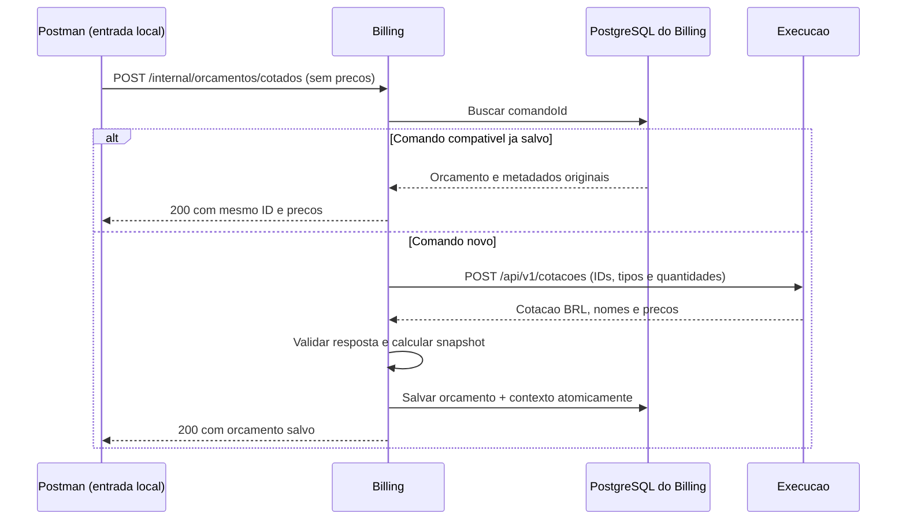

# Billing: fluxo de negócio e guia de integração

**Para quem é:** Gabriel Souza (OS/orquestração), responsável pelo Execução, Pedro (infraestrutura) e demais integrantes.
**Responsável pelo incremento do Billing:** Gabriel Ramos.
**Referência de status:** 03/11/2026. Este documento descreve o código disponível e distingue testes locais de integrações ainda pendentes.

> **Em uma frase:** o Billing transforma peças/serviços em um orçamento com preços congelados,
> gera o checkout no Mercado Pago e registra o resultado financeiro verificado.
> **Ainda não recebe nem publica mensagens SQS da Saga, não aprova o orçamento automaticamente e não altera a OS.**

## 1. Resumo para o grupo

| Entrega | Situação |
|---|---|
| Criar e consultar orçamento no PostgreSQL do Billing | Implementado e testado localmente |
| Consultar preços no Execução via `POST /api/v1/cotacoes` | Implementado; integração local com o Execução e PostgreSQL validada |
| Salvar nomes/preços e contexto da versão do diagnóstico | Implementado; registros conferidos no banco |
| Repetir comando sem duplicar/recalcular orçamento | Implementado e testado; dados diferentes com a mesma chave retornam 409 |
| Criar preferência/link do Checkout Pro | Implementado e validado com Mercado Pago em ambiente de teste |
| Consultar e registrar pagamento aprovado | Implementado e validado no ambiente de teste, com persistência local |
| Receber webhook com assinatura e processar em segundo plano | Implementado; simulador retornou 200 e inbox foi conferida como PROCESSADO |
| Aprovação/reprovação e revisão de orçamento como fluxo de negócio | Pendente de implementação/alinhamento |
| Receber comandos e publicar resultados do Billing por SQS | Pendente; nomes/envelopes precisam de acordo com o OS |
| Reembolso/compensação automática e reconciliação operacional | Pendentes |
| Fluxo completo OS → Billing → Execução no ambiente da equipe | Ainda não validado por estas entregas |

Os testes manuais citados foram realizados por Gabriel Ramos e relatados com prints/resultados de banco.
Pagamento/webhook e cotação foram validados em etapas: isso **não** significa que o orçamento
cotado de R$ 186,00 já percorreu pagamento, mensagens e execução em uma única Saga.

## 2. Quem faz o quê

| Participante | Responsabilidade / limite |
|---|---|
| Cliente | Paga no checkout. Aprovar orçamento é uma decisão de negócio separada do pagamento. |
| Mecânico/operador | Registra diagnóstico e itens no Execução; inicia/conclui o trabalho naquele serviço. |
| OS Service — Souza | Dono da OS e orquestrador. Coordena os passos, decide mudanças de status e envia comandos da Saga. |
| Billing — Ramos | Calcula/persiste orçamento, consulta cotação, gera checkout, verifica e registra pagamento. Não movimenta estoque. |
| Execução Service | Dono do diagnóstico, catálogo e estoque. Fornece preços; reserva peças quando recebe agendamento do OS. |
| Mercado Pago | Hospeda checkout e informa o resultado financeiro. O Billing consulta a API para validar esse resultado. |
| Infraestrutura — Pedro | Disponibiliza rede, endpoints, filas, credenciais/secrets e configuração integrada de deploy, conforme acordo do grupo. |

O Billing **não** publica `AgendarExecucao`/`CancelarExecucao`, não consome `execucao-resultados`
e não altera o banco do Execução. Essas ações pertencem ao desenho OS ↔ Execução.

## 3. Linha do tempo do orçamento cotado — funcionando localmente

| Passo | Ação | Quem executa hoje | Resultado |
|---|---|---|---|
| 1 | Escolher os IDs/tipos/quantidades necessários e informar a revisão do diagnóstico | Postman, simulando a entrada que futuramente virá do OS | Pedido sem preços |
| 2 | Enviar `POST /internal/orcamentos/cotados` | Postman → Billing | Valida comando, IDs, versão e lista |
| 3 | Conferir se `comandoId` já foi processado | Billing → seu PostgreSQL | Se for repetição compatível, devolve o snapshot e não recota |
| 4 | Consultar `POST /api/v1/cotacoes` | Billing → Execução | Obtém nomes e preços atuais, sem reservar estoque |
| 5 | Conferir moeda, itens, tipos, quantidades e valores | Billing | Resposta incompleta/divergente não gera orçamento |
| 6 | Calcular e congelar nomes/preços | Billing | Snapshot imutável, subtotais e total em BRL |
| 7 | Salvar orçamento e metadados na mesma transação | Billing → seu PostgreSQL | Orçamento não fica salvo pela metade |
| 8 | Consultar orçamento salvo | Postman → Billing | Mesmo UUID, itens e total |



O diagrama mostra o caminho de sucesso/repetição; conflito de chave e falhas estão nas seções 7 e 8.
Na integração futura, o OS deverá fornecer a entrada confiável com os itens do diagnóstico.
Hoje o Billing guarda a versão informada, mas **não consulta o diagnóstico nem prova que ela continua atual**.

## 4. Como chamar o Billing no teste de integração

### 4.1 Endereços e perfis

| Ambiente | Endereço | Observação |
|---|---|---|
| Billing com perfil `local` | `http://127.0.0.1:8082` | Rotas `/internal`; somente desenvolvimento, sem JWT |
| Execução no teste local | `http://127.0.0.1:8080` | Precisa estar rodando com DynamoDB local e catálogo preparado |
| Billing com perfil `webhook-demo` | `http://127.0.0.1:8083` | Demonstração do webhook por HTTPS temporário; sem rotas internas/Swagger |
| Endereço definitivo no cluster | A confirmar com infraestrutura | Não presumir que as rotas locais existem no pod |

**Não habilitar `local` no Kubernetes nem expor a porta 8082 em túnel público.**
As rotas locais não são o contrato público/autenticado de produção e não substituem o consumidor SQS.
O endereço `localhost` serve somente quando os dois processos rodam no mesmo computador;
no Kubernetes o Billing deve usar o endereço interno fornecido pela infraestrutura.

### 4.2 Gerar orçamento com cotação

```http
POST /internal/orcamentos/cotados
Content-Type: application/json
```

```json
{
  "comandoId":"22222222-2222-4222-8222-222222222222",
  "ordemId":123,
  "clienteId":1,
  "versaoDiagnostico":2,
  "itens":[
    {"tipo":"PECA","itemId":"filtro-oleo","quantidade":2},
    {"tipo":"SERVICO","itemId":"troca-oleo","quantidade":1}
  ]
}
```

| Campo | Regra / significado |
|---|---|
| `comandoId` | UUID da solicitação. Reenvio da mesma solicitação mantém a chave; outro conteúdo exige outro comando. |
| `ordemId` | ID numérico positivo da OS no modelo atual do Billing; não é o número do pagamento. |
| `clienteId` | ID numérico positivo do cliente; não é CPF nem usuário Mercado Pago. |
| `versaoDiagnostico` | Inteiro positivo com a revisão informada pelo solicitante. Não é versão do orçamento. |
| `itens` | De 1 a 20, sem duplicar a combinação `tipo` + `itemId`. |
| `tipo` | Exatamente `PECA` ou `SERVICO`. |
| `itemId` | Mesmo ID do catálogo do Execução; até 80 caracteres, sem espaços nas pontas. |
| `quantidade` | Inteiro positivo, até o limite de inteiro Java. Quantidade fracionária não é aceita. |

Não enviar preço nem descrição. Se campos extras forem enviados, eles não substituem a cotação:
o Billing usa nomes/valores exclusivamente da resposta do Execução.

Resposta 200: UUID `id` do orçamento, `comandoId`, OS/cliente, `versaoDiagnostico`, `cotacaoGeradaEm`,
`status`, `moeda`, lista de itens, `total` e `criadoEm`. Cada item contém `referencia`, `tipo`,
`descricao`, `quantidade` e `valorUnitario`.

**Mapeamento:** `itemId` do Execução fica em `referencia` do Billing; `nome` fica em `descricao`;
`precoUnitario` fica em `valorUnitario`. Os IDs/tipos/quantidades do catálogo são preservados.
O preço é exato em centavos com BigDecimal, sem arredondamento silencioso.

No teste: 2 filtros de 45.50 + 1 serviço de 95.00 = **186.00 BRL**. É exemplo do catálogo
local preparado, não preço fixo no código. A data e o UUID são gerados/retornados em execução.

### 4.3 Consultar o orçamento salvo

```http
GET /internal/orcamentos/{orcamentoId}
```

`orcamentoId` é o UUID devolvido em `id`. Retorna o snapshot financeiro. Para recuperar o
contexto de cotação, repita o POST compatível (sem nova chamada ao Execução) ou consulte a tabela
de metadados no teste local. Não há GET HTTP específico de metadados neste incremento.

### 4.4 Rotas disponíveis hoje

| Método / rota | O que faz | Disponibilidade |
|---|---|---|
| `POST /internal/orcamentos` | Orçamento com preços informados manualmente; compatibilidade com testes antigos | Só `local`; não usar como entrada confiável de produção |
| `POST /internal/orcamentos/cotados` | Consulta Execução e gera orçamento | Só `local` |
| `GET /internal/orcamentos/{id}` | Consulta snapshot salvo | Só `local` |
| `POST /internal/orcamentos/{id}/preferencia` | Cria ou recupera preferência/link salvo | Só `local`, Mercado Pago configurado |
| `GET /internal/orcamentos/{id}/preferencia` | Consulta o registro local da preferência | Só `local` |
| `POST /internal/orcamentos/{id}/pagamentos/{pagamentoId}/verificar` | Consulta provedor e registra pagamento validado | Só `local`, Mercado Pago configurado |
| `GET /internal/orcamentos/{id}/pagamentos` | Lista pagamentos registrados no banco | Só `local` |
| `POST /webhooks/mercadopago?data.id=...` | Valida assinatura e salva aviso para processamento | Habilitação explícita e segredo; não depende de perfil `local` |

## 5. Checkout, pagamento e webhook — o que funcionou

### 5.1 Criar o link não confirma pagamento

O Billing cria uma **preferência de Checkout Pro** com base no orçamento salvo.
O cliente abre o link e paga no ambiente correspondente. Preferência `CRIADA` significa
que o checkout foi gerado, **não** que o cliente aprovou o orçamento ou pagou.
O ID da preferência, o UUID do orçamento e o ID da operação de pagamento são identificadores diferentes.

Na consulta financeira, o Billing exige: mesma operação solicitada, `external_reference`
igual ao UUID do orçamento, BRL e valor igual ao total salvo, além de dados financeiros válidos.
Resposta de navegador, print do checkout e status enviado pelo chamador não servem como prova.

### 5.2 Webhook automático

1. Mercado Pago envia uma notificação de `payment` para a URL configurada.
2. Billing verifica HMAC-SHA256, timestamp e identificadores assinados.
3. Grava o aviso na inbox durável e só depois responde **200**.
4. Worker consulta `GET /v1/payments/{id}` no provedor; o corpo da notificação não decide o estado financeiro.
5. Confere orçamento/preferência/valor/moeda e grava ou atualiza o pagamento.
6. Marca a entrega como `PROCESSADO`, ou agenda nova tentativa/falha para investigação.

**200 do webhook = aviso recebido e salvo. PROCESSADO = aviso tratado. Nenhum dos dois, sozinho,
significa pagamento aprovado.** Confira também o estado financeiro e `confirmado`.
Notificações diferentes podem ocupar várias linhas de inbox para a mesma operação; a tabela
financeira mantém uma linha por ID do pagamento. Há reservas temporárias e retries limitados.

No teste com Mercado Pago em ambiente de teste, uma operação de **199.80 BRL** ficou
`APROVADO`, `confirmado=true`, com persistência conferida. A simulação do webhook também
retornou 200 e foi conferida no banco como `PROCESSADO`. Esse orçamento é diferente do
exemplo posterior de cotação de 186.00: não são uma única evidência de Saga fim a fim.

## 6. Estados: não confundir quatro coisas diferentes

| Registro | Estado / significado |
|---|---|
| Orçamento | Hoje retorna `AGUARDANDO_APROVACAO`; ainda não há máquina de aprovação/reprovação/revisão implementada. |
| Preferência | `CRIANDO`, `CRIADA`, `FALHA_DEFINITIVA`, `RESULTADO_INCERTO`; controla a solicitação de checkout, não o pagamento. |
| Pagamento | `APROVADO`, `PENDENTE`, `EM_PROCESSAMENTO`, `AUTORIZADO`, `RECUSADO`, `CANCELADO`, `PARCIALMENTE_ESTORNADO`, `ESTORNADO`, `CONTESTADO`, `EM_MEDIACAO`, `DESCONHECIDO`. |
| Inbox webhook | `PENDENTE`, `PROCESSANDO`, `PROCESSADO`, `FALHA`; controla o tratamento da entrega. |

`confirmado=true` só corresponde à aprovação financeira integral validada, sem estorno.
Reconhecer um estorno informado pelo provedor **não** significa que o Billing já saiba solicitar
reembolso. Não há chamada de reembolso implementada.
O pagamento aprovado não altera o status do orçamento ou da OS automaticamente nesta etapa.

## 7. Reenvio, concorrência e versões

- **Mesmo comando + mesmo pedido lógico:** mesmo orçamento, sem recotar e sem duplicar.
  A ordem dos itens pode mudar. OS, cliente, versão, IDs/tipos/quantidades devem continuar iguais.
- **Mesmo comando + pedido diferente:** 409. Não reutilizar a chave para outra revisão/ação.
- **Comando de origem manual usado como cotado:** 409; não atribuirmos origem confiável ao preço antigo.
- **Duas cotações concorrentes do mesmo comando:** primeira gravação confirmada vence;
  chamadas compatíveis retornam o mesmo orçamento, ainda que os preços consultados tenham mudado.
- **Novo comando:** pode produzir outro orçamento com os preços atuais. Não cancela/substitui o anterior automaticamente.
- **Pagamento repetido:** atualiza a operação existente de forma idempotente; dados antigos não sobrescrevem snapshot mais novo.
- **Preferência com resultado incerto:** não repetir cegamente o POST externo; requer reconciliação.
- **Webhook repetido:** entrega autenticada é deduplicada e confirmação financeira continua idempotente.

`versaoDiagnostico`, versão do orçamento aprovado e `schemaVersion` de mensagem são conceitos
diferentes. Só o primeiro já é guardado nesta entrada. Não inventar correspondência entre eles.
Ainda falta acordar releitura do diagnóstico, revisão, aprovação e bloqueio de versões antigas.

## 8. Erros e o que fazer

| Caso | Resposta / tratamento |
|---|---|
| Pedido local inválido ou quantidade fracionária | 400, corrigir entrada |
| Mesmo comando com conteúdo diferente | 409, conferir se é reenvio ou nova ação |
| Execução recusa a cotação com HTTP 400 | Billing retorna 422; conferir catálogo/itens ativos e pedido |
| Cotação desligada/configuração inválida | 503; configurar integração |
| Falha/resposta inválida do Execução | 502; não salva orçamento incompleto |
| Timeout na cotação | 504; não salva novo orçamento por aquela tentativa |
| Orçamento inexistente nas consultas locais | 404 |
| Pagamento não corresponde ao orçamento | 409; não confirmar automaticamente |
| Webhook sem assinatura válida ou fora da tolerância | 401; conferir segredo/relógio/headers, não desligar autenticação |
| Webhook com tipo/ID/corpo incompatível | 400 |
| Inbox não pôde ser persistida | 503/erro 5xx; não responder sucesso antes de salvar |

Falhas temporárias do worker são reagendadas (até 8 reservas/tentativas). Incompatibilidade
financeira ou tentativas esgotadas permanecem como `FALHA` para intervenção. Isso é uma inbox
local em PostgreSQL, **não** uma DLQ SQS. Tratamento de DLQ da Saga não está implementado no Billing.

## 9. Dados e configuração para reproduzir

### Banco do Billing

| Tabela | Conteúdo |
|---|---|
| `orcamentos` | Identificação, comando, OS/cliente, data e total |
| `orcamento_itens` | Referências, tipos, quantidades, nomes e preços congelados |
| `orcamento_cotacoes` | Versão do diagnóstico e data da cotação ligada ao orçamento |
| `preferencias_checkout` | Estado/ID/links da preferência |
| `pagamentos` | Snapshot financeiro mínimo por operação |
| `mercadopago_webhook_inbox` | Entregas autenticadas e controle de processamento |

O banco local do Billing é PostgreSQL em `127.0.0.1:5543`, database `billing_service`, com
credenciais de desenvolvimento definidas no Compose. Não é o DynamoDB do Execução nem RDS compartilhado.
Não colocar segredos de ambientes reais neste documento, em collections, prints ou mensagens.

### Configurações principais

| Uso | Variáveis |
|---|---|
| Cotação | `EXECUCAO_COTACAO_ENABLED=true`, `EXECUCAO_BASE_URL`, opcional `EXECUCAO_COTACAO_TIMEOUT` (padrão 5s) |
| Mercado Pago | `MERCADOPAGO_ENABLED=true`, `MERCADOPAGO_ACCESS_TOKEN` do ambiente correspondente |
| Webhook | `MERCADOPAGO_WEBHOOK_ENABLED=true`, `MERCADOPAGO_WEBHOOK_SECRET`, opcional tolerância (padrão 5m) |
| Banco fora dos padrões locais | `SPRING_DATASOURCE_URL`, `SPRING_DATASOURCE_USERNAME`, `SPRING_DATASOURCE_PASSWORD` |

Integrações são desligadas por padrão. Access Token, Public Key e assinatura secreta do webhook
não são intercambiáveis. Para consultar preços não é necessária credencial Mercado Pago.
O contrato HTTP atual do Execução não implementa autenticação: alinhar serviço-a-serviço com a equipe.

### Guias e collections

- [Cotação e orçamento: passos no IntelliJ, contrato, DBeaver e erros](cotacao-execucao.md).
- [Collection de cotação (separada dos testes de pagamento)](billing-cotacao.postman_collection.json).
- [Checkout Pro e preferência](mercado-pago-checkout-pro.md).
- [Consulta e persistência do pagamento](confirmacao-pagamento.md).
- [Collection de orçamento/checkout/pagamento](billing-local.postman_collection.json).
- [Webhook: configuração de teste, assinatura, inbox e diagnóstico](webhook-mercado-pago.md).

<a id="validacoes"></a>

## 10. O que foi comprovado e o que ainda não foi

| Cenário | Evidência disponível |
|---|---|
| Cotação com Execução local + orçamento 186.00 BRL | Print Postman 200 e 4/4 testes; consulta/persistência confirmada por Ramos |
| Repetição compatível e conflito ao alterar quantidade | Ramos confirmou sucesso dos testes da collection e consulta ao banco |
| Checkout e pagamento em ambiente de teste, 199.80 BRL | Print do pagamento aprovado e consulta do Billing com `confirmado=true` |
| Simulador de webhook e processamento | Print 200 no painel; Ramos confirmou inbox PROCESSADO e pagamento no banco |
| Concorrência, preços distintos em corrida, falhas, rollback, assinatura e timeout | Testes automatizados; não atribuir todos esses cenários ao teste manual |
| Trocar preço no catálogo ou parar Execução durante teste manual | Sugeridos, mas sem confirmação de execução nesta conversa |
| Fluxo integrado SQS, aprovação/revisão, estorno solicitado pelo Billing e deploy fim a fim | Não comprovado / pendente |

Última validação automatizada do código, em **03/11/2026**: Java 21, `clean verify`,
**181 testes aprovados, sem falhas/erros/ignorados; 98,44% de linhas (693/704)**.
Os testes usam H2 e HTTP simulado; o teste manual posterior complementou com Execução real
local e PostgreSQL. Não houve validação de deploy nesta atualização de documentação.

## 11. Próximos acordos para integrar a Saga

### Com Souza — OS Service

1. Fechar o envelope dos comandos do Billing e seus resultados, por exemplo `GerarOrcamento`
   / `OrcamentoGerado` e processamento de pagamento. Nomes de planejamento não são consumidores/eventos já publicados.
2. Definir `sagaId`, `messageId`, `operationId`, `causationId`, datas e versão do schema.
   O `comandoId` UUID da entrada local não deve ser convertido silenciosamente em outro identificador.
3. Compatibilizar IDs: o Execução usa `osId` texto; o Billing atual usa `ordemId`/cliente numéricos positivos.
4. Definir quem lê/revalida o diagnóstico e como controla versões de orçamento/aprovação.
5. Acordar como o Billing devolve os itens da versão aprovada, preservando catálogo/quantidades,
   para o OS montar `AgendarExecucao`. Não usar preços novos para alterar orçamento já aprovado.
6. Definir evento de pagamento confirmado/recusado e comportamento com reenvio/ordem trocada.
7. Combinar compensação: quem solicita estorno, em que ordem cancelar execução e como tratar recusa do cancelamento.

### Com o responsável pelo Execução

- Confirmar que o contrato de cotação permanece compatível e quais itens usar no teste conjunto.
- Alinhar as revisões do diagnóstico e o tratamento de item inativo/ausente.
- A cotação HTTP foi testada; agendamento e movimentação de estoque continuam fora do Billing.

### Com Pedro — infraestrutura

- Endereços internos, autenticação/roteamento, URLs e propriedade Terraform das filas do Billing,
  secrets e variáveis de ambiente. Não reutilizar a fila de resultados do Execução como consumidor do Billing.
- PostgreSQL, migrações versionadas, observabilidade de falhas e configuração do webhook público.
- Já existe workflow de deploy no repositório, adicionado no PR #5; a existência do arquivo
  não é prova de deploy integrado funcionando. Nenhum deploy foi disparado explicitamente nesta
  atualização. **Atenção: o workflow atual reage a push na main, inclusive merge de documentação;
  coordenar o merge com quem mantém as credenciais/infraestrutura.**

**Critério de conclusão futuro:** um teste único em ambiente combinado, da OS/diagnóstico ao
orçamento aprovado, pagamento verificado, eventos processados e agendamento/execução, incluindo
falhas/compensações e duplicatas. Os incrementos atuais são partes reutilizáveis desse fluxo.

## 12. Referências e entregas

- [Fluxo de negócio do Execução — referência complementar](https://github.com/pisanohub/oficina-fiap-execucao-service/blob/main/docs/fluxo-de-negocio.md).
- [Contrato provisório do Execução, especialmente seções 8 e 10](https://github.com/pisanohub/oficina-fiap-execucao-service/blob/main/docs/contrato-provisorio-saga.md).
- [PR #1 — orçamento](https://github.com/pisanohub/oficina-fiap-billing-service/pull/1).
- [PR #2 — preferência Mercado Pago](https://github.com/pisanohub/oficina-fiap-billing-service/pull/2).
- [PR #3 — consulta e registro do pagamento](https://github.com/pisanohub/oficina-fiap-billing-service/pull/3).
- [PR #4 — webhook e inbox](https://github.com/pisanohub/oficina-fiap-billing-service/pull/4).
- [PR #5 — pipeline de deploy Kubernetes](https://github.com/pisanohub/oficina-fiap-billing-service/pull/5).
- [PR #6 — cotação com Execução](https://github.com/pisanohub/oficina-fiap-billing-service/pull/6).
