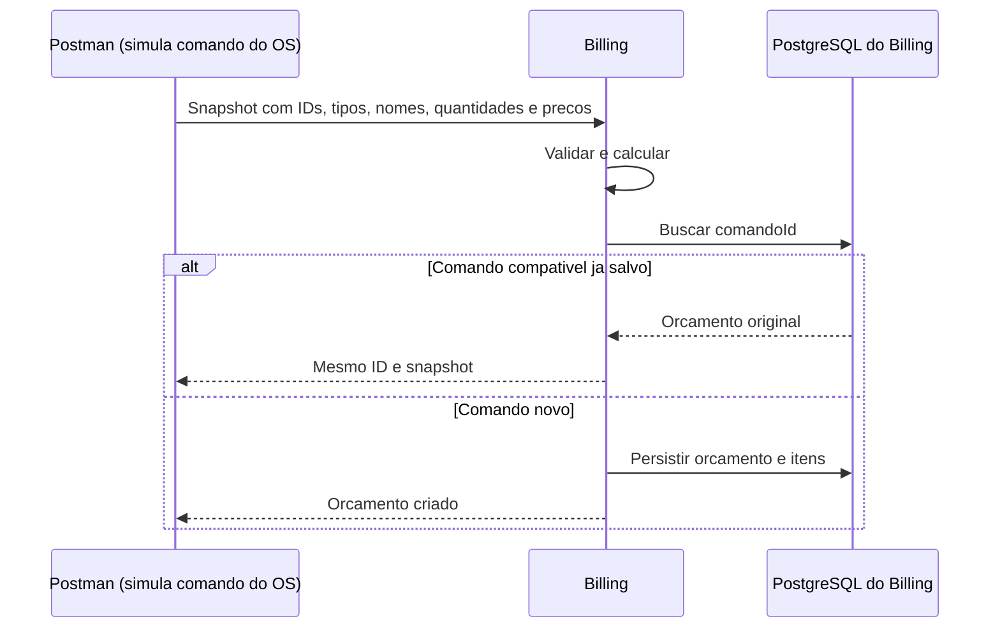

# Billing: fluxo de negócio e integração — ADR-P4

**Atualizado em 04/11/2026.** Para Souza (OS), responsável pelo Execução, Pedro (infra) e grupo.

> O **OS captura o preço ao adicionar o item à OS** e o envia no comando de orçamento.
> O Billing valida, calcula e persiste esse snapshot, **sem consultar o Execução**.
> Pagamento/webhook são reaproveitados; o worker financeiro SQS é opt-in.
> Consulte [pagamento/estorno na mesma fila](comandos-pagamento-mesma-fila.md).
> O [fluxo SQS de orçamento](orcamento-sqs.md) também é opt-in; validação fim a fim ainda pendente.

Referência: [ADR-P4](https://github.com/pisanohub/oficina_fiap/blob/main/documentacao/decisoes-fase4/ADR-P4-saga-orquestrada.md).
O cabeçalho publicado ainda diz Proposta; Pedro confirmou a direção ao solicitar a correção.
Não alteramos documentos/código dos colegas unilateralmente.

## 1. Mudança em relação ao guia anterior

A cotação REST do PR #6 funcionou no teste local, mas foi descartada arquiteturalmente.
Adapter, porta/configuração, fluxo de metadados, rota `/internal/orcamentos/cotados` e
collection antiga foram retirados. O [histórico](cotacao-execucao.md) não é instrução ativa.

A geração lê `GerarOrcamentoCommand` com nomes/preços. Nem um comando novo autoriza buscar
preço mais atual: o Billing usa o snapshot recebido. Alterar catálogo depois não muda o preço.

## 2. Responsabilidades

| Participante | Papel |
|---|---|
| Operador/OS | Durante diagnóstico, adicionar itens; OS consulta catálogo e guarda preço naquele momento (ADR; implementação a validar com Souza). |
| OS — Souza | Orquestrar Saga, controlar OS e publicar comando após SolicitarOrcamento explícito. |
| Billing — Ramos | Ler/validar/calcular/persistir snapshot e integrar Mercado Pago; não consultar catálogo ou movimentar estoque. |
| Execução | Catálogo/estoque e execução; consultado pelo OS, não pelo Billing na geração. |
| Mercado Pago | Checkout e fonte financeira consultada pelo Billing. |
| Pedro | Ambiente, filas/permissões, banco/secrets e deploy integrado conforme acordos. |

Billing não agenda/cancela execução nem consome resultados do Execução.
Preço vindo do canal autorizado do OS não é equivalente a preço público arbitrário do cliente.

## 3. Fluxo e implementação

| Passo | Ação | Situação |
|---|---|---|
| 1 | Adicionar itens em diagnóstico e capturar preço no OS | Responsabilidade do OS conforme ADR |
| 2 | SolicitarOrcamento publica comando com snapshot | Entrada SQS implementada opt-in; integração com OS a validar |
| 3 | Billing lê snapshot, valida e calcula | Implementado; Postman simula comando local |
| 4 | Salvar orçamento/itens no banco próprio | Implementado sem HTTP ao Execução |
| 5 | Publicar resultado e OS reagir | Resposta plana em orcamento-respondido, outbox opt-in; OS a validar |
| 6 | Aprovação, pagamento e continuação da Saga | Checkout/consulta/webhook existem; aprovação/revisão e fluxo completo pendentes |



O diagrama mostra o caminho local de sucesso/repetição, não um consumidor SQS pronto.
Conflitos/rollback estão na seção 6. Não há Execução no caminho da geração do Billing.

## 4. Entrada local e contrato

Java 21, perfil `local`, Billing `http://127.0.0.1:8082`, PostgreSQL `127.0.0.1:5543`.
Não precisa de Execução, DynamoDB ou AWS para gerar/consultar.

```http
POST /internal/orcamentos
Content-Type: application/json
```

```json
{
  "comandoId":"44444444-4444-4444-8444-444444444444",
  "ordemId":123,
  "clienteId":1,
  "itens":[
    {"referencia":"filtro-oleo","tipo":"PECA","descricao":"Filtro de óleo","quantidade":2,"valorUnitario":45.50},
    {"referencia":"troca-oleo","tipo":"SERVICO","descricao":"Troca de óleo","quantidade":1,"valorUnitario":95.00}
  ]
}
```

Resultado: **186.00 BRL**, UUID `id`, itens, comando, OS/cliente, total, criadoEm e status
`AGUARDANDO_APROVACAO`. Consultar: `GET /internal/orcamentos/{id}`.

- comandoId: UUID; ordemId/clienteId: numéricos positivos no modelo atual.
- De 1 a 100 itens, sem referência/tipo repetidos; tipo PECA ou SERVICO.
- Referência até 80 e descrição até 255 caracteres; quantidade inteira positiva.
- valorUnitario: snapshot recebido, não negativo, duas casas, limite numeric(19,2); zero como cortesia é permitido.
- Não há cotacaoGeradaEm/versaoDiagnostico nesta entrada. Versões e contexto precisam ser acordados.

**Este JSON local não define o envelope SQS.** Confirmar com Souza o mapeamento de
ItemOS.precoUnitario para o campo da mensagem; não presumir nomes ou conversão de IDs.

**Segurança:** `/internal` só existe em local e não autentica o OS. Não habilitar local no
Kubernetes nem expor 8082 via túnel. O adapter definitivo deve receber somente comandos
internos autorizados. Receber snapshot não autoriza expor uma API pública de preço arbitrário.

## 5. Pagamento e webhook preservados

| Rota | Função |
|---|---|
| POST/GET /internal/orcamentos[/{id}] | Geração/consulta; só local |
| POST/GET /internal/orcamentos/{id}/preferencia | Checkout; só local |
| POST /internal/orcamentos/{id}/pagamentos/{pagamentoId}/verificar | Consulta financeira validada; só local |
| GET /internal/orcamentos/{id}/pagamentos | Lista resultados salvos; só local |
| POST /webhooks/mercadopago?data.id=... | HMAC/inbox; habilitação explícita e segredo |

Preferência CRIADA não é pagamento aprovado nem aprovação do orçamento. Billing verifica
operação, referência externa do orçamento, BRL e total. Não confia no navegador/corpo do webhook.
Webhook valida assinatura/timestamp, salva inbox, responde 200; worker consulta API e persiste.
**200 = aviso salvo; PROCESSADO = aviso tratado; conferir estado/confirmado para saber se pagou.**

Orçamento, preferência, situação financeira e estado da inbox são coisas diferentes.
O worker financeiro opt-in agora solicita estorno integral com idempotência e publica
resultados via outbox; habilitação e tipos estão no novo guia. Não altera a OS diretamente.
Guias: [Checkout](mercado-pago-checkout-pro.md),
[pagamento](confirmacao-pagamento.md) e [webhook](webhook-mercado-pago.md).
Para túnel de webhook, somente webhook-demo em 8083, sem local.

## 6. Idempotência, banco e falhas

- Mesmo comando/conteúdo normalizado: mesmo orçamento; ordem dos itens faz parte do conteúdo atual.
- Mesmo comando com preço/nome/quantidade/item/OS/cliente diferente: 409, sem sobrescrever.
- Concorrência igual: uma gravação; reler após rollback. Snapshots diferentes: um vence, outro conflita.
- Sem preço, negativo/precisão inválida, quantidade inválida ou duplicata: 400 local.
- Consulta inexistente: 404; UUID malformado: 400. Falha de banco não retorna falso sucesso.
- Não há mais erro de cotação 422/502/504 na geração. Catálogo indisponível não bloqueia snapshot válido.
- Preferência incerta não é reenviada cegamente; pagamento/webhook mantêm idempotência e retries limitados.

Orçamentos/itens continuam em orcamentos/orcamento_itens; preferências/pagamentos/inbox são
preservados. Nenhum DROP, exclusão ou recálculo foi executado. A tabela histórica
orcamento_cotacoes, se existir, não é mais usada/mapeada; eventual limpeza é tarefa separada.
Registros antigos, inclusive do experimento REST, continuam consultáveis.

## 7. Testes e evidências

Use a [collection de snapshot](billing-snapshot-os.postman_collection.json) e o
[guia ADR-P4](snapshot-precos-os.md). A [collection financeira](billing-local.postman_collection.json)
anterior continua compatível.

<a id="validacoes"></a>

| Evidência | Situação |
|---|---|
| Pagamento de teste de 199.80 BRL | Ramos confirmou aprovação, consulta e banco. |
| Webhook com inbox PROCESSADO | Ramos confirmou simulador e banco. |
| Cotação REST local de 186.00 BRL | Passou, mas é histórico do PR #6, caminho retirado. |
| Snapshot sem HTTP ao Execução | Testes automatizados da correção; novo manual usa collection atual. |
| Concorrência/validação e compatibilidade legada | Cobertura automatizada, não apresentar como novo teste manual PostgreSQL. |
| SQS financeira e estorno integral | Implementados opt-in; testes offline, ainda sem validação integrada AWS. |
| SQS de orçamento | Implementado opt-in; testes offline, integração com OS a validar. |
| Aprovação/revisão completas e Saga na AWS | Pendentes de validação conjunta. |

Os 181 testes históricos incluíam cotação removida; resultado atual no
[guia de snapshot](snapshot-precos-os.md#validacao). Não refizemos pagamentos ou alteramos
ambientes dos colegas nesta correção.

## 8. Acordos pendentes

**Souza:** payload/envelope de GerarOrcamento/OrcamentoGerado, IDs/correlação, versões,
autorização/proveniência, aprovação/revisão. Billing usa OS/cliente numéricos; converter
para osId texto explicitamente. Confirmar captura do preço na adição do item e publicação
após SolicitarOrcamento, conforme ADR.

**Filas do Billing citadas no ADR, sem consumer/publisher aqui:** gerar-orcamento (OS → Billing),
orcamento-respondido (Billing → OS), processar-pagamento (OS → Billing), pagamento-confirmado
(Billing → OS). Isso não prova provisionamento nem define o campo type da mensagem.

**Execução:** o OS consulta catálogo; Billing não. Referências antigas de cotação direta
nos documentos do colega precisam ser alinhadas pelo responsável; não alteramos seu repositório.

**Pedro:** filas/permissões, rede/secrets, banco/migrações e teste integrado. CI/Sonar e deploy
foram preservados. **Merge na main pode disparar deploy**; coordenar revisão e horário.

Referências: [ADR-P4](https://github.com/pisanohub/oficina_fiap/blob/main/documentacao/decisoes-fase4/ADR-P4-saga-orquestrada.md)
e [Event Storming](https://github.com/pisanohub/oficina_fiap/blob/main/documentacao/event-storming-saga-v1.md).
